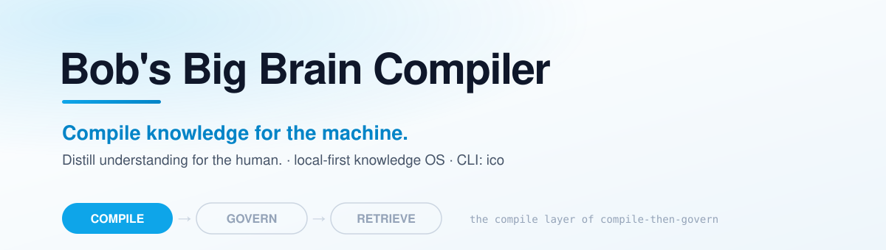

<p align="center">
  <picture>
    <source media="(prefers-color-scheme: dark)" srcset="assets/banner-dark.svg">
    
  </picture>
</p>

# Bob's Big Brain Compiler

<!-- intent-select-partner:start -->

[](https://intentsolutions.io/)

Intent Solutions is a Claude Partner Network Select Services Partner.

<!-- intent-select-partner:end -->

> Formerly `intentional-cognition-os` — the npm package keeps that name.

Bob's Big Brain Compiler reads your documents, notes, and web clips and turns them into an organized, searchable knowledge base — answers include source citations that are checked against the compiled wiki. A citation does not establish that its claim is correct.

A local-first knowledge OS. Point `ico` at a folder of PDFs, markdown notes, and web clips. It compiles them into a queryable wiki you can read, runs grounded Q&A with inline citations, spins up multi-agent research tasks for hard questions, generates spaced-repetition flashcards from what landed, and records supported operations in a protocol-level append-only, hash-chained trace. Single CLI. Model operations send selected source content to the configured provider; choose and provision a local endpoint when content must stay on the machine.

[](LICENSE)
[](https://www.npmjs.com/package/intentional-cognition-os)
[](https://github.com/jeremylongshore/bobs-big-brain-compiler/actions/workflows/ci.yml)
[](https://github.com/jeremylongshore/bobs-big-brain-compiler/releases)

[](https://ko-fi.com/U5S225PTME)

> **Part of the [Bob's Big Brain](https://github.com/intent-solutions-io/bobs-big-brain-umbrella) stack** — this is the **compile** layer. It pairs with [Bob's Big Brain Registrar](https://github.com/jeremylongshore/bobs-big-brain-registrar) (govern) and [qmd](https://github.com/tobi/qmd) (retrieve) to turn raw corpus into governed, citation-backed memory. → [Ecosystem overview](https://github.com/intent-solutions-io/bobs-big-brain-umbrella)

---

## What it actually does

You drop documents into a folder. `ico` reads them, compiles the content into a structured wiki on disk (one markdown file per source, per concept, per topic, per contradiction it found), and then lets you:

- **Ask** a question — get an answer with `[source: <page-title>]` citations checked against compiled page titles. Citation verification checks the reference, not factual correctness.
- **Research** a question that's too big for a single retrieval — `ico` spawns a scoped task workspace through five stages (collector, summarizer, skeptic, integrator, orchestrator). Collection is deterministic; summarizer, skeptic and integrator call the configured model, and the final orchestrator hand-off can call the report renderer and provider too.
- **Render** a report or slide deck from any topic, and **promote** that artifact back into the wiki so the next answer can cite it.
- **Recall** what you ingested — generate flashcards with spaced repetition; export to Anki if you prefer.
- **Audit** recorded operations. Inspect the Compiler JSONL hash chain, SQLite trace index and provenance with `ico audit verify`. Compile traces can carry model-call lineage; the `ask` trace stores counts and retrieved paths, while `ask --json` returns citation details. These are separate from Registrar governance receipts and do not prove what a model used.

It is a cognition runtime, not a chat wrapper. The model proposes; a deterministic kernel owns durable state, traces, and control. **Your data lives in plain markdown + SQLite on your machine.** The model API is called only for the compilation/synthesis/reasoning steps — and only when you trigger them. The backend is a pluggable provider registry: Claude by default, or any OpenAI- or Anthropic-wire provider (OpenAI, Groq, NVIDIA, DeepSeek, MiniMax) or a local server (Ollama, vLLM, LM Studio) via `ICO_PROVIDER` — so you can keep every call on-device if you want to.

---

## Install

```bash
# the npm name predates the repo rename — intentional
npm install -g intentional-cognition-os
ico --version          # compare with the installed artifact; source manifests are 1.23.1
export ICO_PROVIDER=anthropic
export ANTHROPIC_API_KEY=sk-ant-...
# Or use MiniMax-M3: ICO_PROVIDER=minimax, ICO_MODEL=MiniMax-M3,
# with MINIMAX_API_KEY set in the environment.
```

Requires **Node 22+**. Model operations need credentials for the selected hosted provider; a configured local provider can be keyless. pnpm is needed when building from source. Provider settings come from environment variables or the workspace `.env`; see [.env.example](.env.example). For LM Studio, use the OpenAI wire with an explicit `ICO_BASE_URL`, such as `http://localhost:1234/v1`, and the model served there.

From source:

```bash
git clone https://github.com/jeremylongshore/bobs-big-brain-compiler.git
cd bobs-big-brain-compiler
corepack enable
pnpm install --frozen-lockfile
pnpm build
node packages/cli/dist/index.js --version
```

---

## 5-minute quickstart

```bash
# 1. Create a workspace
ico init my-research

# 2. Tell it where your sources live
ico mount add papers ~/Documents/papers --workspace my-research

# 3. Ingest (parses PDFs/MD/web clips into ./raw/)
ico ingest ~/Documents/papers --workspace my-research

# 4. Compile — the configured provider calls happen here
ico compile all --workspace my-research

# 5. Ask
ico ask "How does self-attention scale with sequence length?" \
    --workspace my-research
```

You now have:

- `my-research/wiki/` — readable markdown summary + concept + topic pages, all with frontmatter and inline `[[wikilinks]]`
- `my-research/audit/log.md` — chronological human-readable record of what just happened
- `my-research/audit/traces/*.jsonl` — machine-readable trace events for every step

`ico status` shows counts. `ico lint` audits the wiki for schema drift / staleness / orphans. `tail workspace/audit/log.md` answers "what did I do today."

---

## When to use it (and when not to)

| You want to…                                                               | Use `ico`? | Why                                                      |
| -------------------------------------------------------------------------- | ---------- | -------------------------------------------------------- |
| Build a personal research base from PDFs + notes                           | ✅ Yes     | Core use case                                            |
| Answer questions with traceable citations to your own sources              | ✅ Yes     | Citations are first-class, not bolted on                 |
| Run a multi-step research investigation (literature review, due diligence) | ✅ Yes     | `ico research` spawns scoped agents with a skeptic stage |
| Study what you've collected with spaced repetition                         | ✅ Yes     | `ico recall` builds + scores cards                       |
| Replace your team's wiki / shared docs                                     | ❌ No      | Single-user, single-machine for v1                       |
| Drop into Slack / chat with team-shared memory                             | ❌ No      | No multiplayer, no remote sync yet                       |
| Build a customer-facing chatbot                                            | ❌ No      | Use LangChain / a managed RAG service                    |

---

## Implementation boundaries

| Capability            | Mechanism                                                                  | Limit                                                                   |
| --------------------- | -------------------------------------------------------------------------- | ----------------------------------------------------------------------- |
| Local-first workspace | Markdown plus SQLite                                                       | Configured model endpoints can be remote.                               |
| Compiled knowledge    | Six passes, including deterministic backlink construction                  | Model-derived content still needs evaluation.                           |
| Cited answers         | Page-title references and citation verification                            | A valid reference does not prove a true answer.                         |
| Research              | Five stages, including reasoning agents and a model-backed report hand-off | No separate agent SDK is required by the current implementation.        |
| Recall                | Cards, quizzes, retention scores and Anki export                           | These are distinct from team governance.                                |
| Trace integrity       | JSONL hash links, SQL index and optional external anchors                  | A writer able to replace all retained witnesses can evade local checks. |
| CLI                   | Seventeen top-level command groups                                         | Count from source registration, not a new acceptance test.              |

Historical positioning lives in the design documents. This table describes this
implementation; it is not a current feature audit of other products.

---

## The six layers (architecture in one screen)

```
   L1 raw/          ← what you put in (PDFs, MD, web clips)            PROTOCOL-LEVEL APPEND-ONLY
       ↓                                                                deterministic
   L2 wiki/         ← compiled markdown (sources, concepts, topics,    RECOMPILABLE
                      contradictions, open questions)                   probabilistic
       ↓
   L3 tasks/<id>/   ← scoped episodic research workspaces              PER-TASK
                      (brief, evidence, notes, critique, output)        probabilistic
       ↓
   L4 outputs/      ← rendered reports, slides, briefings              PROMOTABLE
                                                                        probabilistic
       ↓
   L5 recall/       ← flashcards, quizzes, retention scores            ADAPTIVE
                                                                        deterministic
   L6 audit/        ← trace JSONL + audit log + hash chain             PROTOCOL-LEVEL APPEND-ONLY
                                                                        deterministic
```

The hard constraint, drilled through every component: **the model never directly writes to L6 or to promotion tables.** It proposes a summary, a card, a synthesis — the kernel decides whether it lands.

---

## Commands you'll actually use

|                                          |                                                          |
| ---------------------------------------- | -------------------------------------------------------- |
| `ico init <name>`                        | Create a workspace                                       |
| `ico mount add <name> <path>`            | Register a source directory                              |
| `ico ingest <path>`                      | Parse PDFs/MD/web-clips into the raw layer               |
| `ico compile all`                        | Run six passes; backlink construction is deterministic   |
| `ico ask "<question>"`                   | Grounded Q&A with citations                              |
| `ico research "<brief>"`                 | Five-stage research; duration depends on corpus/provider |
| `ico render report --topic <t>`          | Generate a markdown report                               |
| `ico recall generate --topic <t>`        | Build flashcards from compiled wiki                      |
| `ico recall quiz --topic <t>`            | Interactive quiz; tracks retention                       |
| `ico recall export --format anki`        | Anki-importable TSV                                      |
| `ico compile all --changed`              | Compile eligible changed inputs; see command help        |
| `ico spool emit --tenant <id> --dry-run` | Preview the governance hand-off without emitting files   |
| `ico audit verify`                       | Verify Compiler trace/index/provenance evidence          |
| `ico maintain --help`                    | Inspect mounted-source maintenance and lifecycle options |
| `ico lint`                               | Audit the wiki (schema, staleness, orphans)              |
| `ico status` / `ico inspect`             | Workspace summary / per-subsystem detail                 |

Global flags on every command: `--workspace <path>`, `--json`, `--verbose`, `--quiet`. Full reference: `ico --help` or any command with `--help`.

---

## Status

Source checked 2026-10-26 at `9dc7488`: release manifests and the CLI version
are **1.23.1**, with **17 top-level command groups** and **five workspace packages**.
An installed artifact must be checked independently; a matching version label
alone does not identify its payload. Current test and coverage evidence belongs
to the run and commit recorded in [TEST_AUDIT.md](TEST_AUDIT.md) or the relevant PR;
older test totals are not current acceptance evidence.

The exported `packages/compiler/src/version.ts` constant remains `0.1.0`, is pinned
by its unit test and is outside release-please's version updates. It is distinct
from the CLI/release version; this documentation correction changes no code.

The Compiler is the local workspace layer; the separate Registrar/plugin provide
team governance. A repository Claude plugin already exists under `plugin/` for
dog-food workflows. This does not establish the general extension API, remote
workspace service or multi-user Compiler described in the historical phase plan.

---

## Documentation

The detailed specs (architecture, frontmatter schemas, trace event types, promotion rules, etc.) live in [`000-docs/`](000-docs/). Start with [007-PP-PLAN-master-blueprint.md](000-docs/007-PP-PLAN-master-blueprint.md) if you want the authoritative design document, or [003-AT-ARCH-architecture.md](000-docs/003-AT-ARCH-architecture.md) for the system-design view.

Development setup, conventions, PR process: [CONTRIBUTING.md](CONTRIBUTING.md).

Vulnerability reporting: [SECURITY.md](SECURITY.md).

---

## License

Apache-2.0 — see [LICENSE](LICENSE).

## Author

Jeremy Longshore · [intentsolutions.io](https://intentsolutions.io)
